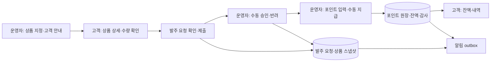

# ORDENOWA 최종 아키텍처 — 상품 발주 요청·운영자 검토·수동 포인트

기준일: 2026-10-29 한국시간. 최신 사용자 설명과 추가 답변을 반영한 **최종 제품 설계 기준**이다. 설계 작성은 코드 구현·검증·출시 완료가 아니다. 검토한 실행 코드는 `364ba34`, 직전 문서 HEAD는 `b30fe13`이다.

## 1. 확정된 플랫폼 컨셉

**운영자가 고객에게 특정 상품의 발주를 안내한다. 고객은 쇼핑몰 물건을 주문하듯 해당 상품 화면에서 수량을 확인하고 발주 요청한다. 운영자는 요청을 수동 검토한 뒤 해당 고객에게 수당 포인트를 수동 지급한다. 고객은 잔액과 적립 내역을 조회한다.**

`운영자 상품 지정·고객 안내 → 고객 상품 확인·발주 요청 → 운영자 수동 검토 → 운영자 포인트 잔액 반영 → 고객 잔액·내역 조회`

사용자가 추가로 확정한 것은 (1) 상품 발주 안내/배정은 운영자가 등록한다, (2) 포인트는 잔액·내역만 표시하며 별도 처리는 운영자가 담당한다는 점이다. 고객이 임의 업무를 생성하거나 일반 작업 결과/증거를 제출하는 업무관리 도구로 확장하지 않는다. 고객의 핵심 제출물은 **상품 발주 요청**이다.

고객 화면은 상품 카드·상세·수량 선택·요청 확인·요청 내역처럼 익숙한 주문 UX를 사용한다. 서비스가 기록하는 것은 내부 발주 요청과 검토/포인트이며, 외부 쇼핑몰 API 주문·실구매·결제·물류를 자동 실행하지 않는다.

### 출시 범위

| 포함 | 포함하지 않는 범위 |
| --- | --- |
| 운영자 상품 등록/선택, 고객별 상품 발주 안내 | 판매 checkout·카드/은행 결제·고객 선입금 |
| 배정 상품 상세·수량·발주 요청 확인·내역 | 배송지·운송장·배송·반품·상품 환불 |
| 요청 수동 승인/반려·사유·내역 | generic 업무유형/작업시작/결과보고·증거 업로드 시스템 |
| 승인 요청에 대한 운영자 수동 포인트 지급/정정 | 승인만으로 자동 적립·상품가격 비율의 자동 수당 |
| 본인 잔액·적립/정정 내역 | 현금환산·충전·사용/양도·고객 출금 신청/송금 처리 UI |
| 회원·권한·문의·알림·감사·복구 | 운영자 별도 처리를 현금 송금 완료로 표시/자동 차감 |

과거 ‘쇼핑몰 판매·배송·반품’ 전제와 ‘작업 수당 포인트까지 전부 제외’ 결정은 위 범위에서 대체한다. 배송·반품·환불 조건/판매계좌/상품판매세금을 출시 입력으로 요구하지 않는다. 수동 수당 포인트는 신규 필수다. 원장 정정은 필요한 기록이며 상품 환불과 다르다. 기존 코드·데이터·과거 QA는 보존한다.

## 2. 구현 방식: 기존 기반 재사용 + 전용 발주 요청 모듈

**권장 기술안:** PrestaShop9.2.0 / Hummingbird2.1.2 / MariaDB10.11 / 기존 child theme·회원·관리자·브랜드·권한·문의 기능을 재사용한다. `ordenowaprocurement` 전용 모듈 안에 `Assignments`, `Requests`, `Reviews`, `Points`, `Audit`, `Notifications` 계층을 둔다. 하나의 앱·DB에서 운영하는 구조이며 새 마이크로서비스나 메시지 브로커를 요구하지 않는다.

| 비교한 접근 | 판단 |
| --- | --- |
| 기존 상품/인증/UI를 재사용하고 발주요청·포인트를 전용 테이블로 구현 | 권장. 쇼핑형 UX와 비결제 요청 기록을 함께 충족하며 DB transaction 단순 |
| native cart→order→bank receipt를 발주/포인트로 이름만 변경 | 주소/가격/세금/결제/배송 의존성 및 서로 다른 원장 혼동 때문에 채택하지 않음 |
| 전면 신규 프레임워크 재개발 | 인증/보안/UI/운영 재검증 부담이 커 현재 권장안 아님 |

이 기술 선택과 아래 v1 제약은 작성자의 구체화이며, 사용자 사업정책으로 합의했다고 표현하지 않는다. PrestaShop 코어·부모테마 직접 수정은 하지 않는다.

## 3. 고객·운영자 화면

### 고객

1. 로그인 후 **발주 안내 상품**: 운영자가 자신에게 보낸 상품 카드·안내·기한(설정된 경우).
2. **상품 상세**: 상품명/설명/이미지, 운영자 안내, 수량, 발주 요청 버튼. 가격을 표시할 경우 ‘참고 가격’으로만 표시하고 결제 금액을 생성하지 않는다. 없는 가격/재고/수당 수치를 만들지 않는다.
3. **발주 요청 확인**: 동일 상품·수량·안내를 요약하고 명시적 제출 버튼으로 요청한다.
4. **내 발주 요청**: 요청번호·상품·수량·요청일·검토 상태·반려 사유·포인트 지급 여부.
5. **포인트**: 현재 잔액, 요청별 실제 적립/정정 내역, 처리일·사유. 승인됐지만 미지급인 요청은 ‘검토 승인·포인트 지급 대기’로 구분한다.
6. 계정·문의·알림.

v1은 **운영자가 보낸 상품1개당 요청1건**으로 구성한다. 여러 상품을 담는 장바구니는 필요하지 않다. 수량 기본값/상한은 운영자가 안내에 저장하고, 고객은1 이상 허용상한 이하만 선택한다. 예시 한도가 없는 경우 임의 무제한 수량을 허용하지 않는다. 이는 단순 구현 제안이며 다품목 발주가 필요해지면 request-line으로 명시 확장한다.

### 운영자

상품 등록/선택 → 고객 선택·발주 안내 발송 → 요청 목록/검색 → 같은 상품·수량·요청 고객 확인 → 수동 승인/반려 → 지급 대기 목록 → 고객·승인요청·정수 포인트·사유 확인 후 **별도 지급 버튼** → 지급/정정·감사 조회.

승인과 포인트 지급은 별도 동작이다. 한 운영자가 둘 다 수행할 수 있으며 초기부터2인 승인을 강제하지 않는다. 고객ID·상품ID·포인트 금액은 서버에서 권한·배정·검토 결과를 다시 확인한다.

## 4. 역할·서버 권한

| 권한 | 책임 |
| --- | --- |
| Customer | 본인에게 유효하게 안내된 상품 조회/요청, 본인 요청·잔액·내역 조회/문의 |
| `procurement.manage` | 상품 참조 등록/선택, 고객별 안내·수량한도·기한, 제출 전 회수 |
| `procurement.review` | 미결 요청의 수동 승인/반려와 고객 공개 사유 |
| `points.award` | 승인 요청의 수당을 명시적으로 수동 지급 |
| `points.correct` | 원본 지급에 연결된 정정·사유 기록 |
| `audit.read` / 관리자 | 허용 범위 감사 조회·운영자 역할/정책 관리 |

목록·검색·상세·직접URL·POST·이미지/첨부·원장 모두 shop/고객/role 검사를 적용한다. 기존 `id_shop`은 설치 경계이며 고객 회사 tenant와 같다고 가정하지 않는다. 고객 회사 조직·멀티테넌시를 이번 요구로 추가하지 않는다.

회원가입/login/reset은 기존 native 기능을 재사용한다. **WorkspaceAccessPolicy**로 서비스 활성·회원 상태·배정 접근을 검사하고 seller CommerceGate와 분리한다. 등록된 고객도 배정 상품이 없으면 빈 안내 목록만 본다. 업무 서비스를 열려고 과거 seller 승인 플래그를 켜지 않는다.

## 5. 상태와 변경 규칙

- 발주 안내: `ACTIVE → REQUESTED`, 또는 제출 전 `CANCELLED/EXPIRED`.
- 고객 발주 요청: `SUBMITTED → APPROVED / REJECTED / CANCELLED`.
- 포인트 표시: 요청 상태와 별개로 `미지급 → 지급 완료`, 정정이 있으면 해당 이력 표시.

고객의 제출은 동일 안내당1번만 허용한다. 제출 후 상품·수량·고객·안내 스냅샷은 변경하지 않는다. 운영자가 안내를 수정/회수했다면 오래된 고객 화면의 제출은 version conflict로 거부한다. 제출과 회수의 동시성은 동일 안내 row lock/version으로 판정한다.

검토 중 상태를 별도 UI로 보여줄 수 있으나 최종 결정은 미결 요청에만1회 저장한다. 미결 요청 취소는 manage/review 권한과 사유를 요구한다. 승인/반려/취소는 해당 요청의 최종 상태이며 되돌려 재승인하지 않는다. 잘못된 상품/수량으로 다시 요청해야 하면 기존 기록을 보존한 채 운영자가 새 안내를 보낸다. 승인 뒤 포인트 오지급은 원장 정정으로 처리한다.

## 6. 전용 데이터 모델

아래는 신규 구현할 논리 테이블이다. 기존 상품 정보는 native Product를 재사용할 수 있지만 native orders/payment/receipt를 새 요청·포인트 원장으로 전용하지 않는다.

| 엔터티 | 주요 필드·제약 |
| --- | --- |
| `procurement_assignment` | shop, customer, product reference, 상품/안내 snapshot, default/max quantity, optional deadline, status, version, issued_by/at. 배정 대상은 고정 |
| `procurement_request` | assignment UNIQUE, shop/customer, request number, immutable 상품/안내/수량 snapshot, submitted_at, status/version, idempotency key/hash |
| `procurement_review` | request UNIQUE, decision, customer-facing reason, internal note, reviewer/time. 최종 결정 기록은 immutable |
| `point_account` | shop/customer UNIQUE, integer balance, version. 원장에서 계산한 조회용 projection |
| `point_award` | request UNIQUE, beneficiary, original review, amount, base ledger entry, actor/time. 승인요청별 기본 지급1회 |
| `point_ledger` | account/award, signed integer delta, 지급/정정유형, original-entry reference, reason, actor/time, idempotency key/hash. append-only |
| `activity_event` | shop, actor type/id, action, 실제 assignment/request/review/ledger target, UTC, correlation. 비밀/본문은 제외 |
| `notification_outbox` | domain event UNIQUE, 수신자/locale/template/안전한target, 전달상태/시도. 인앱·메일·Push bridge |

상품을 나중에 수정하거나 참조가격이 달라져도 이미 제출한 발주 요청의 상품명/수량/안내는 그대로 보존한다. 상품참조는 서버가 동일 id_shop의 id_product인지 검사한다. 옵션 상품은 운영자가 정확한 id_product_attribute를 선택해 상품소속을 검증하고 배정/요청snapshot에 고정한다. 고객이 배정되지 않은 옵션으로 바꿀 수 없으며 화면에서 해당 옵션을 읽기전용으로 표시한다. 고객 정보는 필요한 최소 필드만 저장한다. 비공개 상품 자료/이미지는 webroot 밖의 private storage와 배정권한을 검사하는 download controller로 제공한다. 공개 승인된 상품 이미지만 기존 public derivative를 재사용하며 public image URL을 접근통제로 간주하지 않는다.

shop/customer/status/time/key 인덱스와 pagination을 사용한다. 지급 중복방지의 고유 근거는 변경 가능한 검수 revision이나 네트워크 key만이 아니라 **안정된 발주 요청ID**다.

## 7. 포인트 지급·정정·동시성

포인트는 정수1P 단위를 권장한다. 상품가격×비율·자동수익·현금환산율·가상 예상수당은 생성하지 않는다. 운영자가 실제 승인요청을 보고 금액과 사유를 결정한다. 신규 고객 초기 잔액은0이며 기존 주문/입금값에서 자동 생성하지 않는다.

수동 지급 transaction:

1. 요청→계정 순서로 lock하고 session/권한·shop·고객·APPROVED·미지급을 다시 확인한다.
2. request UNIQUE award와 idempotency를 검사한다. 같은 요청을 서로 다른 key·다른 운영자가 동시에 지급해도 기본 지급1건만 허용한다.
3. 원장·잔액집계·지급기록·감사·알림outbox를 **동일 DB connection의 한 transaction**으로 저장한다. 어떤 단계든 실패하면 모두 rollback한다.
4. commit 후 별도 GET/새session에서 운영자와 고객 화면·DB원장·잔액을 재조회한다. 외부 알림 전달은 commit 뒤 dispatcher가 수행한다. 전송 실패가 지급을 재실행하지 않게 한다.

같은key+같은payload는 기존 결과를 반환하고 같은key+다른고객/금액/요청은 충돌로 거부한다.0/음수/부동소수점 지급·정수overflow/상한초과를 거부한다. UI 버튼 비활성화만으로 중복을 막았다고 판단하지 않는다.

오지급은 원본과 연결된 signed 정정 원장을 추가한다. 예:`+100P 지급 → -20P 사유정정 → 총80P`. 정정 재시도도 멱등이며 업무별 순지급액이0 미만이 되거나 취소누계가 근거금액을 초과하지 않아야 한다. 원본 ledger UPDATE/DELETE·이력소거는 허용하지 않는다. `SUM(ledger.delta)=point_account.balance`를 대조하고 불일치 시 신규지급을 차단·운영알림한다.

외부 별도 처리에 대한 출금/정산/송금 완료나 자동차감은 구현하지 않는다. 고객에게는 ‘수당 포인트’와 적립/정정내역으로만 표시한다.

## 8. 최소 서버 계약

- GET 본인 발주 안내 목록/상세: 활성 배정과 고객범위, 이미 제출/회수/만료 상태 안내.
- POST 발주 요청: session·CSRF·assignment version·상품·수량·기한·유효배정 검증, snapshot 저장·멱등/중복차단.
- GET 내 요청/검토 결과: 본인만·pagination·내부메모 제외.
- POST 운영자 안내/회수: manage·version·상태·이력transaction.
- POST 검토 결정: review·미결요청·최종결정unique·사유/감사.
- POST 포인트 지급/정정: award/correct·승인요청·고정수령자·lock/unique/idempotency.
- GET 본인 잔액/적립내역: session고객만, 원장근거·정정연결.
- GET/POST 문의/알림: 요청ID 관계·owner/role 검증, 공개안내와 내부메모 구분.

실제 URL은 module controller 경로로 구현하고 GET으로 상태/잔액을 변경하지 않는다. 미인증·권한없음·소유권404·stale409·미준비503을 일관되게 적용한다. 다른 고객 ID를 바꿔 보낸 요청에 폼/상품배정·요청/잔액을 노출하지 않고, 거부 후 실제 로그인 고객과 원소유자 상태를 각각 확인한다.

## 9. 기존 구현 재사용과 commerce 분리

| 기존 구현 | 현재 제품에서의 처리 |
| --- | --- |
| 상품 등록·이미지·번역·상품카드/상세·native Product | 상품 참조/쇼핑형 UI 재사용. 배정된 상품만 module 경로에서 보여주며 판매 활성화·checkout에 의존하지 않음 |
| native 회원/Employee·reset·token/ACL·child theme·브랜드/locale | 재사용, 내계정/메뉴를 상품발주안내·요청내역·포인트로 변경 |
| 문의·첨부·owner guard·직원배정 | 요청별 문의 관계에 재사용. 고객에게 발주상품을 보내는 assignment와 상담직원배정은 별개 |
| DB transaction/index·감사 READ/shop/paging·profile versions | 패턴 재사용. 실제 새 request/ledger target/source·운영자/포인트 정책으로 연결 |
| consent/outbox·PWA등록·오프라인 안내 | 재사용, 새발주/검토/포인트 이벤트·수신자·private경로 추가 |
| cart/checkout/payment/bank/carrier/address/returns | 현재UX/직접경로 비활성, 기존코드/테이블/과거QA 보존 |

현재 모듈 `kuraneabusinessprofile.php:352-359`는 회원등록을 seller gate에 연결하고 `ProfileValidator.php:10,33,102` 이후는 판매/배송/환불을 요구한다. 새 WorkspaceAccessPolicy와 운영자/발주·포인트 정책 validator를 분리해야 한다. legacy retail은 메뉴만 숨기지 말고 서버에서도 차단한다.

native product를 reference로 사용할 때 기존 inactive/hidden/non-orderable 보존이 가능하며, 고객의 권한 있는 module 상세를 위해 판매flag를 켜지 않는다. `AssignedProductViewBuilder`가 same-shop 상품/옵션과 배정 snapshot을 검증해 필요한 표시값만 만들며, 기존 ProductController를 공개하거나 parent presenter의 판매 가능 필터를 임의로 완화하지 않는다. 필요 자료는 운영자 수동등록으로 제공할 수 있다. 후속 사용자 지시로 Amazon Japan·Rakuten 가격·상세 설명·사진·원본 카테고리 수집 및 검수 후 분류 연결을 필수 범위에 추가한다. 수동 상품등록 경로도 유지하며 실제 원문 호환과 이미지 공개 권리 근거를 따로 검사한다.100k판매SKU acceptance를 새 출시에 그대로 강제하지 않고 실제 상품/요청량으로 성능기준을 정한다.

운영 정보는 플랫폼 운영자 신원·고객지원·업무/포인트/개인정보·문의정책이다. LOGISTEED reference가 운영권한 증거가 되지는 않는다. 판매자계좌·배송/반품/환불 validator가 현재서비스 게시를 막아서는 안 된다.

## 10. 보안·알림·화면·운영

요청/포인트/배정/검토/개인문의·관리자는 `private,no-store`·noindex·public sitemap 제외다. SW의 path/query controller 목록에 새모듈을 추가하고 제출/지급 POST를 오프라인에서 저장·재전송하지 않는다. 공개승인 상품이미지·정적자산과 고객별 배정정보/잔액을 구분한다.

감사는 안내/회수·고객요청·검토결정·포인트지급/정정·권한/정책변경의 actor/time/action/실제target을 보존한다. 원문 개인정보/토큰/잔액 민감정보를 진단·스크린샷에 남기지 않는다. 고객공개 안내와 내부메모는 서버 view model부터 분리한다.

알림은 상품발주 안내·요청 접수·검토 결과·포인트 지급/정정이다. 인앱 상태가 기준이며 메일/Push 실패와 지급commit은 분리한다. 기존 Push 요구를 임의 제외하지 않으며 실제 provider/worker·동의/철회/재시도·기기수신은 여전히 구현/검증할 항목이다. 별도 메시지브로커 없이 DBoutbox+운영 scheduler로 시작할 수 있다.

고객JA기본/EN·KO·현재운영에 노출되는 전체core/custom 관리자한국어,10개폭·keyboard/수동접근성·독립시각·PWA설치/업데이트·성능 요구를 새 상품요청/포인트 화면에서 검증한다. 보고서생성수와점수통과·클릭proxy와실제INP를 구분한다. 실제 HTTPS/기기검증을 에뮬레이션으로 대체하지 않는다.

운영은 host/domain/TLS·회원복구SMTP·secrets·고정appdigest·migration/rollback·DB/disk/error/backup감시·담당자다. 발주안내/요청/snapshot/검토/원장/잔액/감사/비공개자료를 동일복구시점으로 backup/restore하고 원장합계·상태·ownerACL을 재검증한다. 운영DB·실거래를 이 설계작성에서 변경하지 않는다.

## 11. 과거 QA를 현재 기준으로 바꾸는 방법

과거 #405081성공/#405597실패는 당시 범위로 보존한다. 새 발주요청/포인트 인수로 전용하지 않는다.7개쇼핑몰실패를 그대로 현재차단목록에 두거나 assertion삭제로 PASS로 바꾸지 않는다. 의도된 범위이관과 새검사의 실제outcome을 기록한다.

| 과거 검사 | 현재 출시 처리 |
| --- | --- |
| account 배송주소POST | 회원/login/reset유지, 불필요주소노출차단. 핵심owner검사는 배정상품·발주요청·원장GET/POST |
| catalog import/review/publication | 상품등록/참조·배정상세·고객발주요청·운영검토 재조회. 외부수집·검수·카테고리/하위메뉴 연결은 후속 필수 범위, 판매 checkout 게시 제외 |
| storefront search | 본인안내상품/요청검색과 운영상품/요청검색·고객범위 검사 |
| order rawMIME | 발주안내/요청/검토/포인트알림MIME. reset유지 |
| checkout gate-after-order | retail직접URL거부 + 독립회원/상품요청진입 검증 |
| product sitemap/SEO | 공개소개SEO와 private배정상품/요청/포인트noindex·sitemap제외 |
| perf/accessibility/PWA | 새 상품상세/요청확인/요청내역/포인트/관리자검토 경로에서 기준유지 |
| 배송·반품·환불·판매세금·결제·이체 | 현출시제외, 데이터보존/retail직접노출차단회귀만 |
| 과거WAL전체제외 | 수동승인요청수당POINT는포함. 충전/결제/출금/이전기능은포함하지않음 |

## 12. 현재 구현 상태와 출시 잔여

**설계 작성 시점에는 핵심 기능이 미구현이었다. 후속 구현으로 상품발주안내·전용요청·수동검토·포인트 원장/정정·감사·알림이 추가됐으며 집중 검사를 통과했다. 현재 통합 검증과 운영 인수 상태는 RELEASE_REQUIREMENTS_MATRIX와 TEST_RESULTS를 따른다.** 따라서 배송·환불 요구를 제거해도 현재 즉시 출시 완료는 아니다.

| 우선순위 | 남은 작업 | 완료 조건 |
| --- | --- | --- |
| 1 | 제품경로·회원gate/운영정책분리, retail차단 | seller/배송/환불없이회원/상품요청이용, 기존거래경로서버차단·데이터보존 |
| 2 | 상품선택·고객안내/배정·상품상세/수량/요청확인 | 운영자발송→해당고객만상품조회, 다른고객직접접근차단 |
| 3 | 발주요청·검토·고객내역 | 같은assignment중복요청방지, 수량/상품snapshot보존, 승인/반려/취소·사유/role·새session재조회 |
| 4 | 포인트계정/기본지급/append원장/정정·멱등/동시성 | 명시수동지급정확히1회, 원장=잔액, 실패rollback, 고객새로그인반영 |
| 5 | 감사·문의·알림·새private경로 | 실제request/ledger target·권한/개인정보격리·정확수신·no-store |
| 6 | 새상품요청UI/언어/한국어admin·품질/PWA | 현재경로실측·독립시각·native기기/필수Push검증 |
| 7 | 새출시QA/backup·운영전환 | 안정동일SHA의전체실제outcome·복구/권한·HTTPS/SMTP/digest/rollback/감시인수 |

핵심E2E: `운영자 상품등록/선택 → 고객A에게상품/허용수량안내 → A상품상세/수량/발주요청확인·제출 → 운영자다른session동일요청재조회·수동승인 → 지급권한운영자별도100P지급 → A새로그인잔액/내역100P → -20P사유정정 → 잔액/원장80P`. 숫자는 합성검사값이고 실운영단가가 아니다.

필수부정검사는 고객B의 A상품배정/요청/포인트GET·POST거부+B인증/A보존, 미배정/회수/만료/잘못된수량·stale제출거부, 무권한검토/지급·미승인/반려요청지급거부, 같은·다른key/동시운영자중복지급차단, ledger/balance/audit/outbox단계별실패rollback, 알림실패재전송시중복지급없음, 정정범위/overflow/합계대조, 새session/restart/backup복구다.

## 13. 필요한 운영 입력과 최종 판정

필요한 것은 실제 운영주체/고객지원·초기운영자/참여고객, 안내할 상품/수량과 실제 발주요청샘플·검토기준, 수당포인트지급/정정/이의문의/보존·개인정보정책, host/domain/TLS/SMTP/secrets/backup/감시/복구담당·기기다. 브랜드원본은 재사용한다. 배송지·판매자계좌·운송사·배송/반품/상품환불규정·상품판매세금표는 요구하지 않는다.

**출시 기준은 ‘상품발주안내→고객발주요청→운영자검토→수동포인트→고객잔액조회’가 실제로 동작하고 고객격리·중복/동시성·정정·복구·필수UI/알림·운영인수가 같은 안정SHA에서 통과하는 것**이다. 현재 새핵심구현이 남아 있어 문서수정만으로 출시가능/당일완료를 확약하지 않는다. 선택적인 generic업무관리·ERP·물류·출금개발로 범위를 늘리지 않는다.

## 설계 검토 기록

6개 GPT가 업무모델·원장·기존코드재사용·QA범위·권한·출시운영을 조사했고, 사용자 최종 상품요청 설명으로 일반업무초안을 단순화했다. 새 builder 검토는 핵심 제출계약/취소전이와 지급/고객격리 기준에 중요한 미해결 질문이 없음을 확인했다. 코드재사용 검토의 동일shop·옵션고정·private이미지 조건도 반영했다. 이는 문서/소스 검토이며 runtime QA나 제품구현 완료가 아니다.
